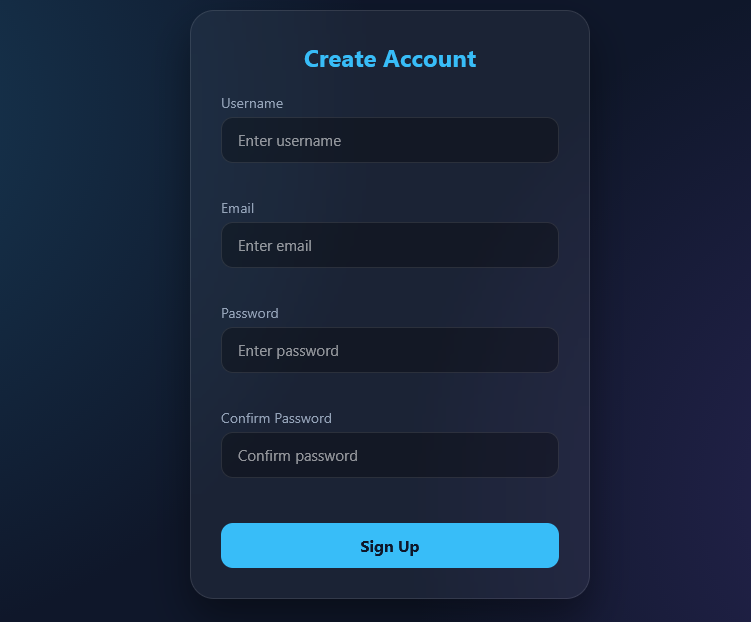

# Registration Form with Real-time Validation

A modern, responsive registration form built with Vanilla JavaScript, featuring real-time client-side validation and a glassmorphism UI.


[](https://ali-ahmed-dev.github.io/registration-form/)

## Preview



## 📌 Features

- **Username Validation**: Ensures the username is not empty and has at least 3 characters.
- **Email Validation**: Uses regular expressions (Regex) to verify a valid email format.
- **Password Strength**: Requires the password to be at least 8 characters long.
- **Confirm Password**: Ensures the confirmation field matches the original password exactly.
- **Real-time Feedback**: Validates inputs as the user types and provides immediate visual feedback (green for valid, red for invalid) along with error messages.
- **Glassmorphism UI**: A modern, responsive dark theme with smooth transitions.

## 🧠 Concepts Practiced

- **Form Handling**: Using `e.preventDefault()` to stop the page from reloading on submit.
- **Regex Validation**: Creating and testing regular expressions to validate email formats.
- **DOM Manipulation**: Updating error messages (`textContent`) and changing element styles (`className`).
- **Event Handling**: Listening to `submit` and `input` events for dynamic validation.
- **Input Validation**: Checking for empty strings (`trim()`), minimum length, and exact matching.

## 🛠️ Technologies Used

- **HTML5**: Semantic structure with native form elements.
- **CSS3**: Flexbox layout, CSS transitions, and glassmorphism design.
- **Vanilla JavaScript**: Pure JS with no external libraries or frameworks.

## 📁 Project Structure

```text
registration-form/
│
├── index.html
├── style.css
├── script.js
├── preview.png
├── README.md
└── LICENSE
```

## ▶️ How to Run Locally

1. Clone the repository:
   ```bash
   git clone https://github.com/ali-ahmed-dev/registration-form.git
   ```
2. Navigate to the project directory:
   ```bash
   cd registration-form
   ```
3. Open `index.html` in your browser (or use Live Server in VS Code).

## 📄 License

This project is licensed under the **MIT License**. See the [LICENSE](LICENSE) file for details.

## Author

**Ali Ahmed**

- GitHub: [@ali-ahmed-dev](https://github.com/ali-ahmed-dev)
- Project Repository: [registration-form](https://github.com/ali-ahmed-dev/registration-form)
